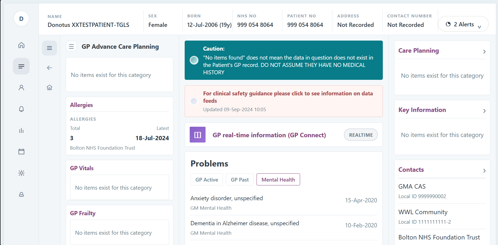
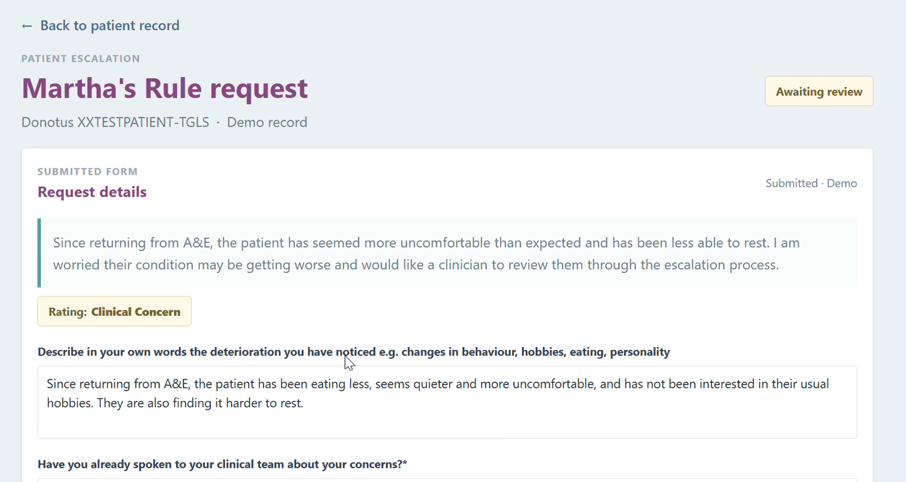
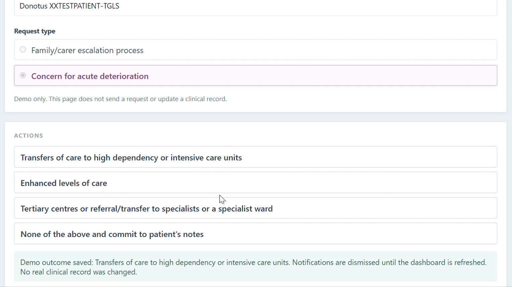
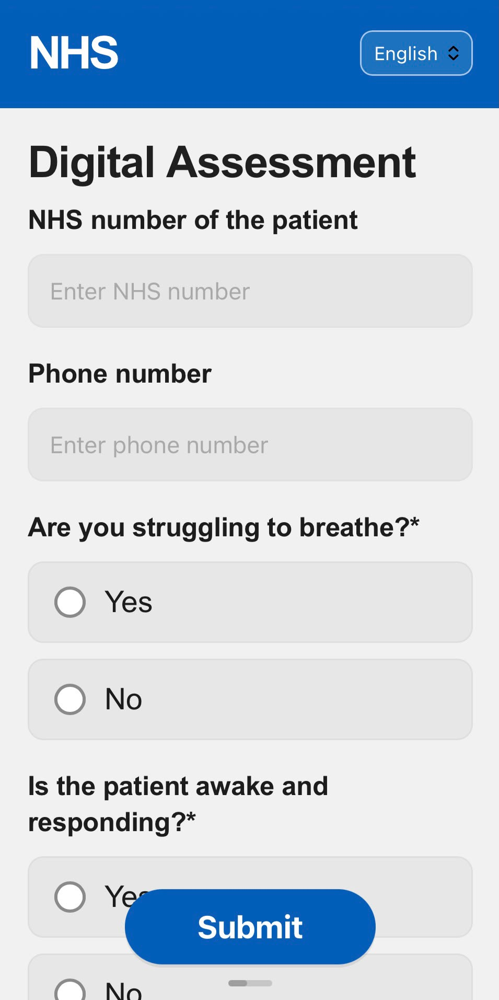
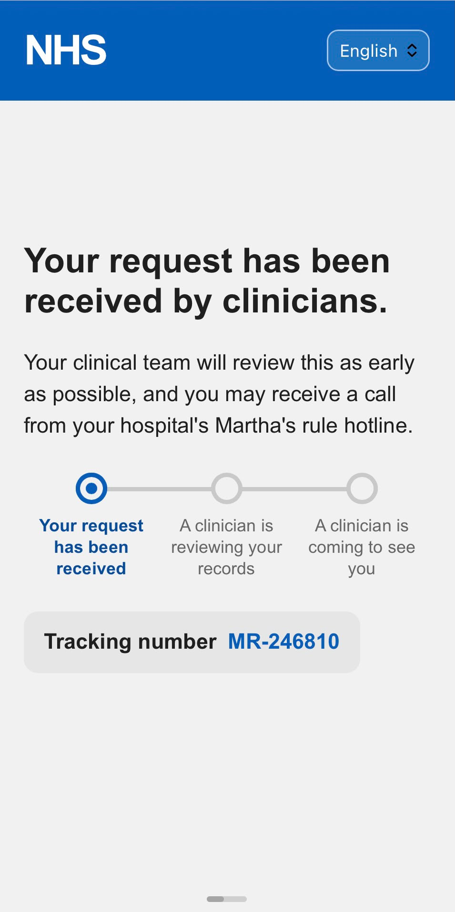

# national-medtech-hackathon
This project is a software implementation of Martha's Rule presented in a mock-up of the NHS Greater Manchester Hive site, focused on the doctor-facing experience. It demonstrates how a doctor can review a family or carer escalation, see information about acute deterioration, and record an action. This is a prototype and is not connected to NHS systems or intended for clinical use.

## Media

  
  
  
  
  
  

## Why Martha's Rule matters
Reported figures that motivate this demo:

- 83% of Martha's Rule calls related to acute deterioration would not have triggered escalation via the Early Warning Score.
- 20,961 Martha's Rule calls were made; the highest proportion (72%) came through the family/carer escalation process.
- 6,035 escalation calls (29%) related to acute deterioration.

## Run locally
From the repository root, enter the frontend folder and start the server:

cd frontend
`npm start`
Then open http://localhost:3000.

## Project structure
`frontend/` contains the dashboard, Martha's Rule request page, shared styles, and npm start script.
`backend/` contains the Node.js static-file server.